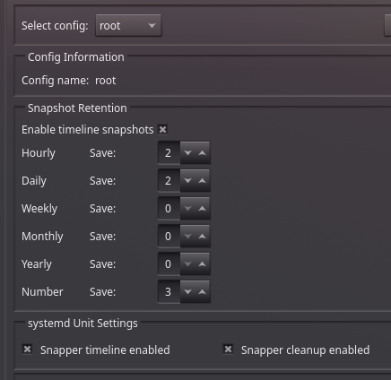

# Omarchy System Setup Guide

A setup guide for Omarchy 4. Omarchy 4 uses Hyprland Lua user overrides and a
Quickshell-based desktop shell. Do not copy the old Waybar, SwayOSD, hypridle,
or custom lid-switch instructions from older Omarchy releases.

---

## Table of Contents

1. [Initial Software Installation](#initial-software-installation)
2. [Keyboard Configuration](#keyboard-configuration)
3. [Restore Configurations](#restore-configurations)
4. [Hyprland Display Management](#hyprland-display-management)
5. [UI Customization](#ui-customization)
6. [Window Manager Configuration](#window-manager-configuration)
7. [Login and Lock Screens](#login-and-lock-screens)
8. [System Services](#system-services) — includes macOS-style safe sleep (19) and keyboard backlight idle-off (19b)
9. [Backup Configuration](#backup-configuration)
10. [Development Tools](#development-tools)
11. [Audio Configuration](#audio-configuration)

---

## Initial Software Installation

### 1. Install Google Chrome

Download and install Google Chrome browser.

### 2. Install Warp Terminal

Install Warp terminal **before** running OS updates:

```bash
curl -L -O "https://releases.warp.dev/stable/v0.2026.02.04.08.20.stable_03/warp-terminal-v0.2026.02.04.08.20.stable_03-1-x86_64.pkg.tar.zst"
```

---

## Keyboard Configuration

### 3. Setup keyd for macOS-style Keyboard Mapping

Install and configure keyd to remap keyboard controls:

```bash
yay -S keyd
sudo mkdir -p /etc/keyd
```

Create the configuration file:

```bash
sudo tee /etc/keyd/default.conf << 'EOF'
[ids]
*

[main]
leftcontrol = leftmeta
leftmeta = leftalt
leftalt = leftcontrol

rightcontrol = rightmeta
rightmeta = rightalt
rightalt = rightcontrol
EOF
```

Enable and start the service:

```bash
sudo systemctl enable --now keyd
sudo keyd reload
```

### 3b. Map the ASUS Fn keys that emit fake combos

The G16's EC sends some Fn keys as hardcoded Windows key combos rather than
dedicated keycodes. Fn+F6 (the "screenshot" keycap) arrives as
**Shift+Alt+S** (the Windows snipping-tool shortcut). Map it to the Omarchy
screenshot in `~/.config/hypr/bindings.lua` (PRINT stays bound for external
keyboards):

```lua
o.bind("SHIFT + ALT + S", "Screenshot", "omarchy-capture-screenshot")
```

Fn+F2/F3 (keyboard backlight) are different: the EC handles them entirely in
hardware and sends nothing to Linux — see [19b](#19b-keyboard-backlight-on-while-typing-off-when-idle-asus).

---

### 3c. Fix Touchpad Palm Jumps While Typing (keyd + disable-while-typing)

Symptom: while typing, a palm brushes the touchpad and the cursor jumps.
Hyprland's `disable_while_typing` is on (default), but it never fires.

Cause: libinput only pauses an internal touchpad for typing on an *internal*
keyboard. keyd grabs the real keyboards (`ITE Device 0b05:19b6`, `AT Translated
Set 2`) and re-emits keys from `keyd virtual keyboard`, which has no
`ID_INTEGRATION`, so libinput treats it as external and never pairs it with
the touchpad. (The ASUS `0b05:19b6` quirk from the
[CachyOS thread](https://discuss.cachyos.org/t/trying-to-get-libinput-to-respect-disable-while-typing-for-touchpad-setting/10030)
already ships upstream in `50-system-asus.quirks`; that is not the problem here.)

Fix: mark keyd's virtual keyboard as internal.

```bash
pkexec bash -c 'mkdir -p /etc/libinput && cat > /etc/libinput/local-overrides.quirks << "EOF"
# Treat keyd'"'"'s virtual keyboard as the laptop'"'"'s built-in keyboard so the
# touchpad'"'"'s disable-while-typing works.
[keyd virtual keyboard]
MatchUdevType=keyboard
MatchName=keyd*keyboard
AttrKeyboardIntegration=internal
EOF'
```

Log out and back in (or reboot). Verify, with `libinput-tools` installed:

```bash
sudo libinput quirks list /dev/input/$(grep -l "keyd virtual keyboard" /sys/class/input/event*/device/name | cut -d/ -f5)
# expect: AttrKeyboardIntegration=internal
sudo libinput debug-events --verbose 2>&1 | grep -i dwt   # type: "dwt activated"
```

## Restore Configurations

### 4. Restore Dotfiles

Restore dotfiles or full home directory from your backup location.

---

## Hyprland Display Management

### 5. Use Omarchy 4 Lid and Sleep Handling

Omarchy 4 handles lid events, clamshell mode, display reconciliation, and
sleep locking through its built-in Hyprland bindings and system helpers. Do
not create a custom lid script, add legacy `bindl` rules, or run the old idle
daemon for this purpose.

The native bindings call:

- `omarchy-system-lid-close` when the lid closes
- `omarchy-hyprland-monitor-clamshell` when the lid opens
- `omarchy-system-sleep-monitor` to lock before suspend

Inspect the active bindings and sleep monitor with:

```bash
omarchy menu keybindings --print
pgrep -a omarchy-system-sleep-monitor
```

### 6. Configure Monitors

Omarchy 4 monitor overrides belong in `~/.config/hypr/monitors.lua`:

```lua
local omarchy_gdk_scale = 2
local omarchy_monitor_scale = "auto"

hl.env("GDK_SCALE", tostring(omarchy_gdk_scale))
hl.monitor({ output = "", mode = "preferred", position = "auto", scale = omarchy_monitor_scale })
```

List connected monitors and supported modes with:

```bash
hyprctl monitors all
```

Do not edit `/usr/share/omarchy/` or the generated defaults under
`~/.local/share/omarchy/`.

---

## UI Customization

### 7. Install Inter Font

Install the Inter font family for system-wide use.

### 8. Configure Font Rendering

Create or edit `~/.config/fontconfig/fonts.conf` and add the following inside the `<fontconfig>` block:

```xml
<!-- Font rendering settings for macOS-like appearance -->
<match target="pattern">
  <edit name="antialias" mode="assign"><bool>true</bool></edit>
  <edit name="hinting" mode="assign"><bool>true</bool></edit>
  <edit name="hintstyle" mode="assign"><const>hintslight</const></edit>
  <edit name="lcdfilter" mode="assign"><const>lcddefault</const></edit>
  <edit name="rgba" mode="assign"><const>rgb</const></edit>
  <edit name="stem-darkening" mode="assign"><bool>true</bool></edit>
  <edit name="stemdarkening" mode="assign"><bool>true</bool></edit>
</match>
```

### 9. Install Icon Theme

Install Colloid icon theme from: https://github.com/vinceliuice/Colloid-icon-theme

This repository is already cloned at `~/devcave/Colloid-icon-theme`. Install the
user icon theme without `sudo`:

```bash
cd ~/devcave/Colloid-icon-theme
./install.sh
```

### 10. Configure GTK Theme Settings

Install and use nwg-look:

- Set default font to **Inter**
- Enable all antialiasing options
- Set icon theme to **Colloid**

For Omarchy themes, keep a small user overlay so theme changes do not restore
the stock Yaru icon theme. For example, create
`~/.config/omarchy/themes/tokyo-night/icons.theme` containing:

```text
Colloid-Dark
```

Re-apply the theme after creating the overlay:

```bash
omarchy theme set tokyo-night
```

---

## Window Manager Configuration

### 11. Configure Blur Effects

Edit `~/.config/hypr/looknfeel.lua`, not the legacy `looknfeel.conf`:

```lua
hl.config({
  decoration = {
    blur = {
      enabled = true,
      size = 7,
      passes = 3,
      ignore_opacity = true,
      noise = 0.06,
      contrast = 1.5,
      xray = false,
      new_optimizations = true,
      popups = true,
      special = true,
    },
  },
})
```

### 12. Enable Rounded Windows

In `~/.config/hypr/looknfeel.lua`:

```lua
hl.config({
  decoration = {
    rounding = 8,
  },
})
```

### 13. Configure Input Settings

In `~/.config/hypr/input.lua`, enable natural scrolling for both mouse and
touchpad, three-finger workspace gestures, and border resizing:

```lua
hl.config({
  input = {
    natural_scroll = true,
    touchpad = {
      natural_scroll = true,
      clickfinger_behavior = true,
      scroll_factor = 0.4,
    },
  },
})

hl.gesture({ fingers = 3, direction = "horizontal", action = "workspace" })
```

In `~/.config/hypr/looknfeel.lua`:

```lua
hl.config({
  general = {
    resize_on_border = true,
    extend_border_grab_area = 15,
    hover_icon_on_border = true,
  },
})
```

After changing any Hyprland Lua file, validate the configuration:

```bash
hyprctl reload
hyprctl configerrors
```

### 14. Configure Omarchy Minimize (OmaVeil)

Download the Omarchy 4-compatible release. The old GitHub release uses legacy
Hyprland dispatch syntax and does not work with Omarchy 4:

```bash
curl -fL https://github.com/somtooo/OmaVeil/releases/download/2/omaveil -o /tmp/omaveil
sudo install -m 0755 /tmp/omaveil /usr/local/bin/omaveil
```

The installed binary should be at:

```
/usr/local/bin/omaveil
```

To build from the local source instead:

```bash
cd ~/devcave/OmaVeil/omaveil
cargo build --release
sudo install -m 0755 target/release/omaveil /usr/local/bin/omaveil
```

Add the keybindings to `~/.config/hypr/bindings.lua`:

```lua
o.bind("SUPER + H", "Minimize window", "omaveil minimize")
o.bind("SUPER + I", "Browse minimized windows", "omaveil restore")
o.bind("SUPER + U", "Restore last minimized", "omaveil restore-last")
o.bind("SUPER + SHIFT + U", "Restore all minimized", "omaveil restore-all")
```

Verify the executable and bindings:

```bash
omaveil show
omarchy menu keybindings --print
```

### 15. Auto-hide the Status Bar

The bar auto-hides via the `quattrobar-autohide` Python script (repo already
cloned at `~/devcave/quattrobar-autohide`, source:
https://github.com/somtooo/quattrobar-autohide). It hides the bar when a window
overlaps it and reveals it when the cursor hits the top screen edge.

```bash
cd ~/devcave/quattrobar-autohide
make install   # installs to ~/.local/bin
```

Then autostart it from `~/.config/hypr/autostart.lua`:

```lua
o.launch_on_start("quattrobar-autohide")
```

> **With the pill bar clone (below):** use the patched copy at
> `scripts/quattrobar-autohide` in this repo — it nudges `som2.bar` (not
> `omarchy.bar`) after flag flips and accounts for the pill's extra height.

### 15b. Floating Pill Bar (som2.bar)

The status bar is a user plugin clone of `omarchy.bar` restyled as a
floating frosted-glass pill (rounded ends, 4px margins, drop shadow,
double-tap transparency preserved). Full details in
[bar-plugin.md](bar-plugin.md).

```bash
mkdir -p ~/.config/omarchy/plugins/som2.bar
cp -r bar-plugin/Bar.qml bar-plugin/BarModel.js bar-plugin/manifest.json \
      bar-plugin/widgets bar-plugin/indicators \
      ~/.config/omarchy/plugins/som2.bar/
omarchy plugin enable som2.bar
omarchy plugin disable omarchy.bar
omarchy restart shell
```

### 16. Clipboard History

Omarchy 4 includes a native clipboard manager. It records text and image
history through the running Quickshell session and stores it under
`~/.local/state/omarchy/`.

- `SUPER + V`: universal paste
- `SUPER + CTRL + V`: open the clipboard history picker
- `CTRL + SHIFT + V`: terminal paste in applications that support that shortcut

Do not add a separate `cliphist` watcher or a `SUPER + V` cliphist pipeline;
that conflicts with Omarchy's universal paste and native picker. Verify the
native watcher and history file with:

```bash
pgrep -a -f 'wl-paste.*shell/plugins/clipboard/capture.sh'
test -s ~/.local/state/omarchy/clipboard-history.json
```

---

## Login and Lock Screens

macOS-style SDDM login theme and lock screen plugin (blurred wallpaper,
circular avatar, frosted pill password field, big clock on the lock screen).
Full install/revert instructions and all theme files are in
[login-and-lock-screens.md](login-and-lock-screens.md).

Quick summary:

```bash
# SDDM login theme
pkexec bash -c 'mkdir -p /usr/share/sddm/themes/macos && cp sddm-macos-theme/* /usr/share/sddm/themes/macos/'
pkexec sed -i 's/^Current=.*/Current=macos/' /etc/sddm.conf.d/10-theme.conf

# Lock screen plugin
mkdir -p ~/.config/omarchy/plugins/som2.lock ~/.local/share/login-look
cp lock-screen-plugin/* ~/.config/omarchy/plugins/som2.lock/
cp sddm-macos-theme/avatar.png ~/.local/share/login-look/
omarchy plugin enable som2.lock
```

---

## System Services

### 17. DisplayLink Driver Setup

If using a DisplayLink dock:

1. Install evdi driver
2. Install displaylink driver
3. **Restart the PC after installation**

### 18. Enable Suspend

Omarchy 4 manages suspend availability through the system menu. Check whether
the suspend action is enabled with:

```bash
omarchy toggle enabled suspend
```

If it is disabled, toggle it with `omarchy toggle suspend`. Do not add a
separate legacy suspend or hypridle service.

### 19. Sleep, Suspend, and Hibernation

> **Hardware:** ASUS ROG Zephyrus G16 GU605CR, BIOS 311 (Intel Core Ultra 9
> 285H + NVIDIA RTX 5070 Ti Mobile, hybrid Intel iGPU + NVIDIA dGPU, Limine UKI,
> encrypted Btrfs `/` on `/dev/mapper/root`, swapfile at `/swap/swapfile`).
> Driver: `nvidia-open-dkms` 615.78.08.
>
> Goal: lid close / menu Suspend goes into **deep (S3)** sleep, hibernates to
> disk after 35 min, and hibernate **powers off cleanly**. Resume restores the
> full session.

Files for this section live in [`sleep/`](sleep/).

**1. NVIDIA sleep options and services.** Shadow the packaged
`nvidia-sleep.conf` (same filename in `/etc/modprobe.d/` replaces it):

- `NVreg_UseKernelSuspendNotifiers=0` makes `/proc/driver/nvidia/suspend`
  exist (the packaged `=1` suppresses it and breaks suspend/hibernate).
- `NVreg_TemporaryFilePath=/var/tmp` puts the VRAM dump on disk (the `/tmp`
  default is tmpfs, too small for 12 GB).
- Keep `NVreg_PreserveVideoMemoryAllocations=1` (packaged default). With `0`,
  hibernate silently skips writing the image.

```bash
pkexec bash -c 'cat > /etc/modprobe.d/nvidia-sleep.conf << "EOF"
options nvidia NVreg_UseKernelSuspendNotifiers=0 NVreg_EnableS0ixPowerManagement=1 NVreg_TemporaryFilePath=/var/tmp
EOF'

pkexec systemctl enable nvidia-hibernate.service nvidia-resume.service nvidia-suspend.service nvidia-suspend-then-hibernate.service

# Keep nvidia out of the initramfs (early KMS breaks hibernate resume).
pkexec bash -c 'mv /etc/mkinitcpio.conf.d/nvidia.conf /etc/mkinitcpio.conf.d/nvidia.conf.disabled && limine-mkinitcpio'
```

**2. Patch the NVIDIA driver so hibernate can power off.** This is the real
fix for "hibernate writes the image but the laptop never turns off".
`HibernateMode=shutdown` ends in `kernel_power_off()` → `device_shutdown()` →
`nv_pci_shutdown()`, which runs `nv_linux_stop_open_q()` and
`nvidia_modeset_remove()` → `nv_drm_dev_unload()`. That waits forever on an
nvkms modeset lock. The driver already bails out on this path when the GPU is
in use, but only *after* those calls. The patch moves the same check in front
of them. Source: [NVIDIA forum thread, post #5](https://forums.developer.nvidia.com/t/hibernate-never-powers-off-stuck-in-nv-pci-shutdown-nv-drm-dev-unload-rtx-5070-laptop-nvidia-open-610-57/382485).

```bash
pkexec ./sleep/nvidia-shutdown-fix/apply.sh   # patch, rebuild DKMS for all kernels, verify
# full reboot afterwards (not a hibernate/resume)
```

The script is pinned to 615.78.08 and **must be re-run after every
`nvidia-open-dkms` update** (the update replaces the source). Bump `VER` in
`apply.sh`/`revert.sh` and check the patch still applies. Gotchas hit while
building it: `dkms install --force` alone reuses the old build (use `dkms build
--force` first), and `grep -q` under `pipefail` reports a false failure.
`revert.sh` undoes it.

**3. Keyboard backlight off before hibernate.** The ASUS EC stalls power-off
while the keyboard backlight is on; Omarchy ships the hook but not executable.
Re-apply after Omarchy updates until fixed upstream:

```bash
pkexec chmod +x /usr/lib/systemd/system-sleep/keyboard-backlight
```

**4. Hibernate via shutdown, after 35 min of suspend.**

```bash
pkexec bash -c 'mkdir -p /etc/systemd/sleep.conf.d
printf "[Sleep]\nHibernateMode=shutdown\n" > /etc/systemd/sleep.conf.d/hibernate-mode.conf
printf "[Sleep]\nHibernateDelaySec=35min\n" > /etc/systemd/sleep.conf.d/hibernate-delay.conf'
```

**5. Deep sleep and lid close.**

```bash
pkexec ./sleep/install.sh      # undo: pkexec ./sleep/uninstall.sh
```

This installs:

- `MemorySleepMode=deep`: s2idle drained the battery; S3 resumes fine on BIOS
  311. (An earlier note here said S3 hangs; that hang was a dead NVIDIA GPU,
  see "GPU dies after resume" below, not S3.)
- `HandleLidSwitch=suspend-then-hibernate` (also on AC). By default logind does
  a plain `suspend` on lid close, which never hibernates.

The menu's Suspend item runs plain `systemctl suspend` by default. Override it
in `~/.config/omarchy/extensions/omarchy-menu.jsonc`, then `omarchy-menu refresh`:

```jsonc
  "system.suspend": {
    "action": "systemctl suspend-then-hibernate"
  }
```

**6. Stop the lock-before-suspend service from hanging suspend.** Omarchy 4.0.2's
`omarchy-sleep-lock.service` crash-loops (holding a sleep inhibitor) when the
session is already locked, which blocks suspend indefinitely. Bound its restart
loop so it fails fast and suspend proceeds:

```bash
pkexec bash -c 'mkdir -p /etc/systemd/user/omarchy-sleep-lock.service.d && cat > /etc/systemd/user/omarchy-sleep-lock.service.d/no-crash-loop.conf << "EOF"
[Unit]
StartLimitIntervalSec=30
StartLimitBurst=10

[Service]
StartLimitAction=none
RestartSec=1
EOF'
systemctl --user daemon-reload
```

#### GPU dies after resume (only after a forced power-off): just reboot

Symptom: after resuming from hibernate, about 3 minutes later the dGPU dies.
The log shows `ACPI Error: Aborting method \_SB.PC00.RP12.PXSX._DSM`
(`AE_AML_NO_RETURN_VALUE`, "Result stack is empty"), then
`gpuGc6EntryGpuPowerOff_IMPL: Call to power off GPU failed`, then a flood of
`GspRmFree failed` / `rpcSendMessage failed`. Anything sleep-related after that
hangs (`nvidia-sleep.sh` blocks on an RM lock), so suspend looks like "screen
off, fans on".

Cause: after a forced power-off the firmware adds a **BERT** table (CPU
machine-check records) on the next boot. That shifts every later ACPI table
down one page; the NVIDIA table `OptRf2 Opt2Tabl` (`SSDT25`, holds the JT/GC6
`_DSM`) moves from `0x67F3C000` to `0x67F3B000`. Linux executes AML straight
from table memory, which is not in the hibernate image. Hibernate from a BERT
boot, and the clean resume boot puts the tables back, so the restored kernel
runs the GC6 power-off (`NVJT` fn 3 → `GC6I`) from the wrong bytes.

Evidence from 40 boots: all 3 hibernates in a BERT boot hit the failure; ~20
hibernates in normal boots never did.

Nothing is left broken. It only happens when you hibernate in the first boot
after a forced power-off, and one normal reboot clears the BERT and restores
everything. If the GPU dies after a resume, reboot (don't suspend; that will
hang). To check whether the current boot is a BERT boot:
`ls /sys/firmware/acpi/tables/BERT`.

#### Verify

```bash
grep -E "PreserveVideoMemoryAllocations|UseKernelSuspendNotifiers" /proc/driver/nvidia/params
# expect: PreserveVideoMemoryAllocations: 1, UseKernelSuspendNotifiers: 0
zstd -dc /usr/lib/modules/$(uname -r)/updates/dkms/nvidia.ko.zst | strings | grep -c "Hibernate shutdown fix"  # 1
cat /sys/power/mem_sleep          # s2idle [deep]  (set at sleep time by systemd)
systemd-analyze cat-config systemd/sleep.conf | grep -E "^(MemorySleepMode|HibernateMode|HibernateDelaySec)"
busctl get-property org.freedesktop.login1 /org/freedesktop/login1 org.freedesktop.login1.Manager HandleLidSwitch
systemctl is-enabled nvidia-hibernate nvidia-resume nvidia-suspend

# Hibernate test: writes the image, powers OFF by itself.
systemctl hibernate
# After resume, wait 5 min idle, then expect 0:
journalctl -b -k | grep -c "power off GPU failed"

# Deep suspend test:
systemctl suspend && journalctl -b -k | grep "suspend entry (deep)"
```

Notes:
- To test the timed path, temporarily set `HibernateDelaySec=3min` and run
  `systemctl suspend-then-hibernate`.
- Resume-from-hibernate always lands on the SDDM login (expected on an
  encrypted disk). The session is restored after you log in.
- After many failed login/sudo attempts, PAM `pam_faillock` bans the account
  for 2 minutes and rejects even the correct password. If the lock screen or
  sudo suddenly rejects a known-good password, wait 2 minutes and retry.

### 19b. Keyboard Backlight: On While Typing, Off When Idle (ASUS)

> **Hardware:** ASUS ROG Zephyrus G16 GU605CR. Works on any ASUS laptop
> exposing `/sys/class/leds/asus::kbd_backlight`.

ASUS laptops leave the keyboard backlight on permanently at whatever level
was last set. This installs `kbd-backlightd`, a small Python daemon (stdlib
only) that gives the Dell-style behavior: the backlight lights when you type
or touch the touchpad, and turns off after 30s of no input. It handles
suspend/resume and reboot correctly.

Behavior:

- Any keyboard or touchpad activity: backlight on, instantly, at your level.
- 30s without input: backlight off.
- Super+F2 / Super+F3 (physical Ctrl+F2/F3 with the keyd macOS map): adjust
  the level, 0-3, with the Omarchy OSD. 0 = off until you raise it again.
- The level survives sleep, hibernate, and reboot.

Note on the Fn keys: on this machine the EC handles Fn+F2/F3 (keyboard
backlight) entirely in hardware and sends nothing to Linux, so they can't be
used for control or OSD. Use Super+F2/F3 instead; the daemon re-asserts its
level on the next input event if the EC keys are pressed.

#### Install

Scripts live in [`scripts/kbd-backlight/`](scripts/kbd-backlight/):

```bash
sudo install -Dm755 scripts/kbd-backlight/kbd-backlightd /usr/local/bin/kbd-backlightd
sudo install -Dm755 scripts/kbd-backlight/kbd-backlight /usr/local/bin/kbd-backlight
sudo install -Dm644 scripts/kbd-backlight/kbd-backlightd.service /etc/systemd/system/kbd-backlightd.service
sudo systemctl daemon-reload
sudo systemctl enable --now kbd-backlightd.service
```

Add to `~/.config/hypr/bindings.lua`:

```lua
o.bind("SUPER + F2", "Keyboard brightness down", "kbd-backlight down", { locked = true })
o.bind("SUPER + F3", "Keyboard brightness up", "kbd-backlight up", { locked = true })
```

#### Verify

```bash
systemctl status kbd-backlightd.service
kbd-backlight up      # level +1, OSD appears
kbd-backlight down    # level -1
# Hands off keyboard and touchpad ~35s: backlight turns off.
# Type or touch the touchpad: instantly back at your level.
```

#### Configure

Idle timeout (default 30s):

```bash
sudo systemctl edit kbd-backlightd
```

```ini
[Service]
Environment=IDLE_SECS=15
```

Then `sudo systemctl restart kbd-backlightd`.

#### Uninstall

```bash
sudo systemctl disable --now kbd-backlightd.service
sudo rm /usr/local/bin/kbd-backlightd /usr/local/bin/kbd-backlight \
        /etc/systemd/system/kbd-backlightd.service
sudo rm -rf /var/lib/kbd-backlightd
sudo systemctl daemon-reload
# and remove the SUPER+F2/F3 binds from ~/.config/hypr/bindings.lua
```

#### If the backlight dies completely (MCU wedge)

Symptom: the keyboard backlight is fully dark, the sysfs register
(`/sys/class/leds/asus::kbd_backlight/brightness`) accepts writes and reads
back the value you wrote, but the physical LEDs never light — and even the
hardware Fn+F2/F3 keys (which bypass Linux entirely) do nothing. A plain
reboot does not fix it, because the keyboard MCU (an ITE 8910 USB device)
stays powered through warm reboots. This has been observed after suspend
cycles on this machine.

Fix — USB-reset the keyboard MCU to force it to re-enumerate:

```bash
# Find the device node (usually 3-6):
for d in /sys/bus/usb/devices/*; do
  [ "$(cat $d/product 2>/dev/null)" = "ITE Device(8910)" ] && basename $d
done

# Reset it (replace 3-6 with the node found above):
echo "3-6" | sudo tee /sys/bus/usb/drivers/usb/unbind
sleep 2
echo "3-6" | sudo tee /sys/bus/usb/drivers/usb/bind

# Backlight should respond again:
echo 3 | sudo tee /sys/class/leds/asus::kbd_backlight/brightness
```

If the USB reset does not bring it back: full shutdown (not reboot), wait
10s, power on. Last resort: shutdown, unplug the charger, hold the power
button 30s to drain residual power and cold-boot the EC.

### 20. Setup Btrfs Snapshots

Omarchy creates Snapper snapshots for system updates. These are separate from
Pika Backup and can be used for system rollback. Check the existing snapshots
with:

```bash
sudo snapper -c root list
```

For regular timeline snapshots, configure the `root` profile in
**Btrfs Assistant** and enable the Snapper timers:

```bash
sudo snapper -c root set-config \
  TIMELINE_CREATE=yes \
  TIMELINE_LIMIT_HOURLY=2 \
  TIMELINE_LIMIT_DAILY=2 \
  TIMELINE_LIMIT_WEEKLY=0 \
  TIMELINE_LIMIT_MONTHLY=0 \
  TIMELINE_LIMIT_YEARLY=0
sudo systemctl enable --now snapper-timeline.timer snapper-cleanup.timer
```

`snapper-timeline.timer` creates the snapshots. The cleanup timer only removes
old snapshots; enabling cleanup alone does not create them. Keep Omarchy's
number-snapshot retention setting when changing timeline retention so update
rollback snapshots are not removed prematurely.


---

## Backup Configuration

### 21. Mount Google Drive with rclone

#### Prerequisites

- Install rclone: `pacman -S rclone`
- Configure Google Drive remote: `rclone config` -  [rclone-gdrive](https://rclone.org/drive/)

#### Setup

**Create mount directory:**

```bash
sudo mkdir -p /media/gdrive
sudo chown $USER:$USER /media/gdrive
```

**Create systemd user service:**

Create `~/.config/systemd/user/rclone-gdrive.service`:

```ini
[Unit]
Description=Mount Google Drive with rclone
After=network-online.target

[Service]
Type=notify
ExecStart=/usr/bin/rclone mount g-drive: /media/gdrive --vfs-cache-mode full
ExecStop=/usr/bin/fusermount3 -u /media/gdrive
Restart=on-failure
RestartSec=5

[Install]
WantedBy=default.target
```

**Enable and start the service:**

```bash
systemctl --user daemon-reload
systemctl --user enable --now rclone-gdrive.service
```

#### Usage

Check status:

```bash
systemctl --user status rclone-gdrive.service
```

Manual control:

```bash
systemctl --user stop rclone-gdrive.service
systemctl --user start rclone-gdrive.service
```

#### Notes

- Using `/media` ensures Nautilus displays the mount with a drive icon in the sidebar
- `--vfs-cache-mode full` enables full file caching, required for apps like Pika Backup
- The service auto-starts on login and restarts on failure

### 22. Configure Pika Backup

1. Install **Pika Backup**
2. Configure backup destination to `/media/gdrive`
3. Set backup schedule:
   - **Hourly**: 1 backup
   - **Daily**: 3 backups
   - **Weekly**: 1 backup
4. Enable "Regularly create backups"

---

## Development Tools

### 23. Install Zed Editor

1. Install Zed from their official website (not from AUR)
2. Add the binary installation location to PATH if not already added
3. Verify `zed` CLI command works

---

## Audio Configuration

### 24. Use the Omarchy 4 Audio OSD

Omarchy 4 replaced SwayOSD with a Quickshell-based OSD. Do not install or
configure `swayosd`; the old `max_volume = 150` setting is not supported by
the native volume command.

Use the native audio commands instead:

```bash
omarchy audio output volume raise
omarchy audio output volume lower
omarchy audio output volume mute-toggle
omarchy audio output volume +1
omarchy audio output volume -1
```

The volume keys and audio panel use the same commands and show the native
Omarchy OSD automatically.

## Additional Resources

- [Hyprland Documentation](https://wiki.hyprland.org/)
- [rclone Documentation](https://rclone.org/)

---
